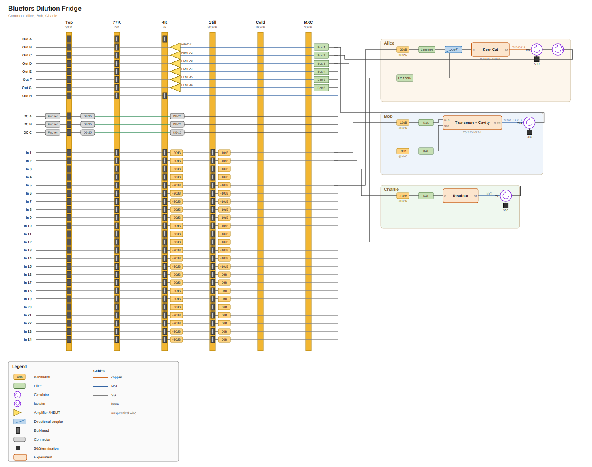

# Wiagram

Turn plain-text fridge wiring files into a PDF and PNG diagram.

Each person keeps their own file (`bob.txt`, `alice.txt`, …) next to a shared
`common.txt`. Wiagram merges them and draws the whole fridge. Wiring changes
live in git like code, and every push rebuilds the diagrams.



*Output of `python3 -m wiagram build example/`  fridge lines on the left,
owner bands on the right.*

## Install / run

```bash
pip install networkx cairosvg
```

Then, from the repo root:

```bash
python3 -m wiagram check example/     # validate only
python3 -m wiagram build example/     # writes example/wiring.pdf, wiring.png, errors.log
python3 -m wiagram toolbox            # refreshes TOOLBOX.md and toolbox.png
```

`check` also accepts a list of files (`common.txt` is always loaded first).

| Command | What it does |
|---------|----------------|
| `check <dir or files>` | Parse and validate. Prints counts and warnings; exits `1` on errors. |
| `build <dir>` | Same as check, then writes `wiring.pdf`, `wiring.png` and `errors.log` into the folder. |
| `import <odg> -o <dir>` | One-time conversion of a LibreOffice drawing into a fridge folder (see below). |
| `toolbox` | Regenerates `TOOLBOX.md` / `toolbox.png` from the parser tables. |

## File layout

A fridge folder always holds the same set of files; versions live in git:

```
fridge/
  common.txt    # plates, line templates, line list (shared)
  bob.txt       # Bob's devices + wiring
  alice.txt     # Alice's devices + wiring
  wiring.pdf    # generated
  wiring.png    # generated
  errors.log    # generated: empty when the build succeeded
```

Then:

```bash
python3 -m wiagram build fridge/
```

### Errors

`build` is all-or-nothing. If any file has a problem, every error is listed in
`fridge/errors.log` as `file:line: message` and the previous `wiring.pdf` /
`wiring.png` are left untouched. On success `errors.log` is emptied.
Warnings (such as a declared device that is not wired to any fridge line) are
printed by `check`/`build` but do not stop the build.

### Automatic rebuilds

`.github/workflows/wiring.yml` runs on every push that touches a `.txt` file.
It builds each folder that has a `common.txt`, refreshes the toolbox, and
commits the resulting `wiring.pdf`, `wiring.png`, `errors.log`, `TOOLBOX.md`
and `toolbox.png`. The job itself always passes; look at `errors.log` in your
fridge folder to see whether your change built. Pull after pushing to get
the regenerated diagram.

## Toolbox

[`TOOLBOX.md`](TOOLBOX.md) lists every component you can type (inline parts,
device types with their default ports, cable and section syntax) and
`toolbox.png` shows the symbols. Both are generated from the parser, so they
are always in sync with what the files accept.

## Your wiring file

Minimal shape:

1. Optional metadata (`owner: …`)
2. `[device …]` / `[cable …]` declarations
3. A `[wiring]` section of arrow chains

Example (`bob.txt`-style):

```
owner: Bob

[device cavity]
type: experiment
label: Transmon + Cavity
serial: TS20231027-1
plate: MXC
ports: ro_in:W, qubit:W, ro_out:E

[device c24]
type: circulator
label: C24

[cable nb1]
type: NbTi
serial: ZS20211123-3

[wiring]
In 1 -> -10dB@MXC -> knl -> cavity.ro_in
In 2 -> -3dB@MXC -> knl -> cavity.qubit
cavity.ro_out -> nb1 -> c24.1
c24.2 -> Out B
c24.3 -> term
```

Chains read **left → right**: fridge line toward your experiment (or back out
to an output line).

### What can appear in a chain?

| Kind | How to write it | Notes |
|------|-----------------|--------|
| Fridge line | `In 1`, `Out B`, `DC A` | Defined in `common.txt`. Each line can be used **once** across all files. |
| Inline 2-port | `-20dB`, `knl`, `hemt(A1)`, … | No declaration needed. |
| Plate anchor | `-10dB@MXC` | Pins that part to a plate column. |
| Declared device | `cavity.ro_in`, `c24.1` | Use `name.port`. |
| Declared cable | `… -> nb1 -> …` | Goes between two components. |

Inline parts you can type directly (full list with meanings in
[`TOOLBOX.md`](TOOLBOX.md)):

```
-20dB   0dB   eccosorb   knl   lp(12GHz)   hp(...)   bp(...)
filter(anything)   hemt(A1)   amp(SPA)   iso   isolator
bulkhead   db25   fischer   sma   term   term(50)
cable(NbTi)   biastee   circ(C24)   coupler
```

`#` starts a comment. A chain can wrap across lines if the continued line
ends with `->`.

### Declaring devices and cables

**Devices** (multi-port or anything you want named):

```
[device name]
type: circulator | isolator | coupler | biastee | experiment | …
label: optional display name
serial: optional
plate: MXC          # optional default plate
ports: a:W, b:E     # required for experiment/device; optional :W/:E/:N/:S
```

Default ports if you do not list them:

- circulator → `1`, `2`, `3`
- coupler → `in`, `out`, `cpl`, `iso`
- bias tee → `rf`, `dc`, `out`
- most others → `in`, `out`

**Cables** (for serials / wire color):

```
[cable nb1]
type: NbTi          # copper, SS, NbTi, premade, flex, loom, …
serial: ZS20211123-3
```

Use the cable name between two parts: `cavity.ro_out -> nb1 -> c24.1`.

## `common.txt` (shared fridge)

Holds things that rarely change: temperature plates, line templates, and the
list of fridge lines.

```
owner: Common
fridge: Bluefors Dilution Fridge

[plates]
Top: 300K
77K: 77K
4K: 4K
Still: 800mK
Cold: 100mK
MXC: 20mK

[template input_line]
group: Inputs
chain: bulkhead@Top -> cable(SS) -> bulkhead@77K -> cable(SS) -> bulkhead@4K ->
       -20dB@4K -> cable(SS) -> bulkhead@Still -> {still}@Still -> cable(SS)

[lines]
In 1..In 15: input_line(still=-10dB)
In 16..In 24: input_line(still=0dB)
```

- `[plates]`  vertical plate bars on the diagram (names used by `@Plate`).
- `[template name]`  reusable chain; `{param}` is filled in per line.
- `[lines]`  creates each fridge line from a template. Ranges work:
  `In 1..In 24`, `Out A..Out H`, `DC A..DC C`.
- `direction: out` on a template flips amplifier symbols for outgoing lines.
- `group:` controls vertical grouping (Outputs / DC / Inputs).

See `example/common.txt` for a full fridge.

## Importing an old LibreOffice diagram (new fridge only)

The `.odg` drawings are only used once, to bootstrap a new fridge folder.
After that the `.txt` files are the source of truth.

```bash
python3 -m wiagram import wiring_diagram_oxford.odg -o oxford/
```

This writes `common.txt` (plates, line templates, `[lines]` ranges) and
`extracted.txt` (everything on the MXC side: circulator stacks, Eccosorb
filters, couplers, experiments and their wiring, with cable materials taken
from the wire colours), then builds the folder. Anything in the drawing that
could not be resolved is printed to stderr as `import: ...` lines, for
example a wire that ends in empty space or a box with no wires. Proofread
those, then split `extracted.txt` into owner files like `bob.txt` if you
want. `tools/extract_odg.py` is the same converter as a standalone script
(`--draft` prints `common.txt` to stdout).

## What the diagram looks like

- **Left:** fridge lines as horizontal tracks, plates as vertical bars.
- **Right:** one tinted band per owner; each `[wiring]` chain is a row.
- Chains that continue from the previous chain’s rightmost part stay on the
  same row; a hang off a downward port (e.g. circulator `3` → `term`) drops
  below.
- Same text always produces the same layout.