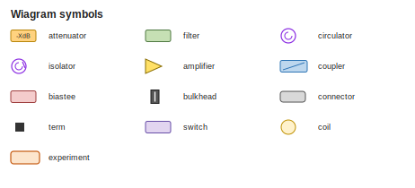

# Wiagram toolbox

Everything you can write in a `.txt` wiring file.  This file is generated
by `python3 -m wiagram toolbox` from the parser tables; edit the code, not
this file.  `toolbox.png` next to it shows what each symbol looks like.



## Chains

```
In 1 -> -10dB@MXC -> knl -> cable(copper) -> cavity.ro_in
cavity.ro_out -> nb1 -> c24.1
c24.2 -> cable(NbTi) -> Out B
c24.3 -> term
```

- Elements are joined by `->` and read left to right: from a fridge line
  towards your experiment, or from the experiment back to an output line.
- A fridge line (`In 1`, `Out B`, `DC A`) can only start or end a chain and
  can be used **once** across all files of a fridge.
- `name.port` picks a port of a declared device; a bare `name` on a two-port
  device goes in at `in` and out at `out`.
- `part@Plate` pins an inline part to a plate column (plates come from
  `[plates]` in `common.txt`).
- A cable (`cable(NbTi)` or a declared `[cable]`) sits *between* two parts:
  never two in a row, never first or last.
- `term` ends a chain; nothing can follow it.
- A chain may wrap onto the next line if the line ends with `->`.
- `#` starts a comment.
- Each port can be connected once; a second use is an error that names the
  first use.
- A device that is declared but never connected to a fridge line is reported
  as a warning.

## Inline parts (no declaration needed)

| Write | Example | Kind | Meaning |
|-------|---------|------|---------|
| `<n>dB` | `-20dB` | attenuator | attenuator; the number is the label (0dB for a plain through) |
| `term, term(<label>)` | `term(50)` | term | termination / 50 Ohm load; ends the chain |
| `eccosorb` | `eccosorb` | filter | Eccosorb infrared filter |
| `knl, knl(<model>)` | `knl(6L250)` | filter | K&L low-pass filter |
| `lp(<f>), hp(<f>), bp(<f>)` | `lp(12GHz)` | filter | low-/high-/band-pass filter with its corner frequency or model |
| `filter(<label>)` | `filter(ZX75-...)` | filter | any other filter; the label is printed under the symbol |
| `hemt, hemt(<name>)` | `hemt(A1)` | amplifier | HEMT amplifier (usually in the output line templates) |
| `amp, amp(<name>)` | `amp(TWPA)` | amplifier | any other amplifier (TWPA, SPA, JPA ...) |
| `bulkhead` | `bulkhead@4K` | bulkhead | SMA bulkhead feedthrough on a plate |
| `db25` | `db25@Top` | connector | DB-25 connector (DC looms) |
| `fischer` | `fischer` | connector | Fischer connector |
| `sma` | `sma` | connector | SMA adapter / connector |
| `cable(<type>)` | `cable(NbTi)` | cable | a cable between two parts (SS, NbTi, copper, premade, loom ...); sets the wire colour |
| `coupler, coupler(<label>)` | `coupler(-20dB)` | coupler | directional coupler, passes in->out; use a [device] to wire cpl/iso |
| `biastee` | `biastee` | biastee | bias tee, passes rf->out; use a [device] to wire the dc port |
| `circ(<label>)` | `circ(C7)` | circulator | circulator used in-line, passes 1->2; use a [device] to wire port 3 |
| `iso, iso(<label>)` | `iso(LNF)` | isolator | isolator |

## Declared devices

```
[device c24]
type: circulator      # one of the kinds below (aliases allowed)
label: C24            # optional, printed under the symbol
serial: TS20231027-1  # optional
plate: MXC            # optional default plate
ports: in:W, out:E    # experiment/device: name your ports; :W/:E/:N/:S sets the side
color: #c55a11        # optional
note: anything        # optional
```

| `type:` (aliases) | Default ports | Through a chain | Meaning |
|-------------------|---------------|-----------------|---------|
| `amplifier` (`amp`, `hemt`) | `in`, `out` | `in` -> `out` | HEMT, TWPA, SPA ... (symbol flips on `direction: out` lines) |
| `attenuator` (`atten`) | `in`, `out` | `in` -> `out` | fixed attenuator |
| `biastee` (`bias tee`, `bias-tee`) | `rf`, `dc`, `out` | `rf` -> `out` | bias tee |
| `bulkhead` | `in`, `out` | `in` -> `out` | SMA bulkhead feedthrough on a plate |
| `circulator` | `1`, `2`, `3` | `1` -> `2` | 3-port circulator (1 -> 2 -> 3 -> 1) |
| `coil` (`magnet`) | `in`, `out` | `in` -> `out` | magnet coil |
| `connector` | `in`, `out` | `in` -> `out` | DB-25, Fischer, SMA adapters ... |
| `coupler` (`directional coupler`, `directional_coupler`) | `in`, `out`, `cpl`, `iso` | `in` -> `out` | directional coupler |
| `device` (`box`) | from `ports:` (or whatever you use in a chain) | needs explicit `.port` | generic multi-port box; ports are whatever you name |
| `experiment` (`sample`) | from `ports:` (or whatever you use in a chain) | needs explicit `.port` | your sample / cavity / chip; ports are whatever you name |
| `filter` | `in`, `out` | `in` -> `out` | any filter (low-pass, Eccosorb, K&L ...) |
| `isolator` (`iso`) | `in`, `out` | `in` -> `out` | isolator (a circulator with port 3 terminated) |
| `switch` | `in`, `out` | `in` -> `out` | microwave switch |
| `term` (`termination`, `load`) | `p` | ends the chain | 50 Ohm termination; ends a chain |

## Declared cables

```
[cable nb1]
type: NbTi            # copper, SS, NbTi, premade, flex, loom ... (sets the colour)
serial: ZS20211123-3  # optional
label: optional
```

Use it between two parts: `cavity.ro_out -> nb1 -> c24.1`.

## Metadata

At the top of any file: `owner: Theo` names the band your wiring is drawn
in.  `common.txt` also has `fridge: <title>`.

## `common.txt` sections

| Section | Contents |
|---------|----------|
| `[plates]` | `Name: temperature`, one per line, warm to cold. Names are used by `@Name`. |
| `[template name]` | `chain:` with `{param}` placeholders; `group:` for vertical grouping; `direction: out` for output lines. |
| `[lines]` | `In 1..In 24: template(param=value)` creates the fridge lines; ranges over numbers or letters. |
| `[wiring]` | arrow chains (same as in owner files). |

